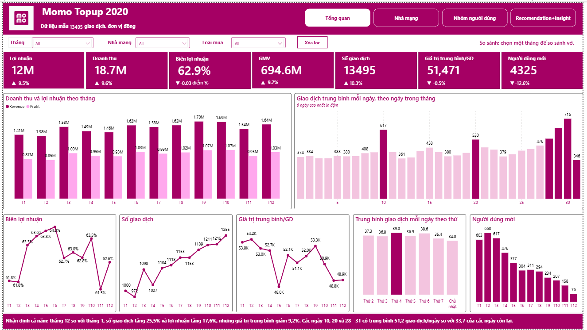
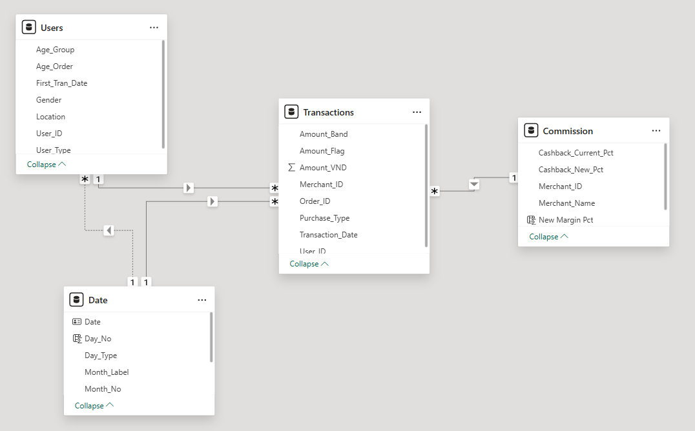
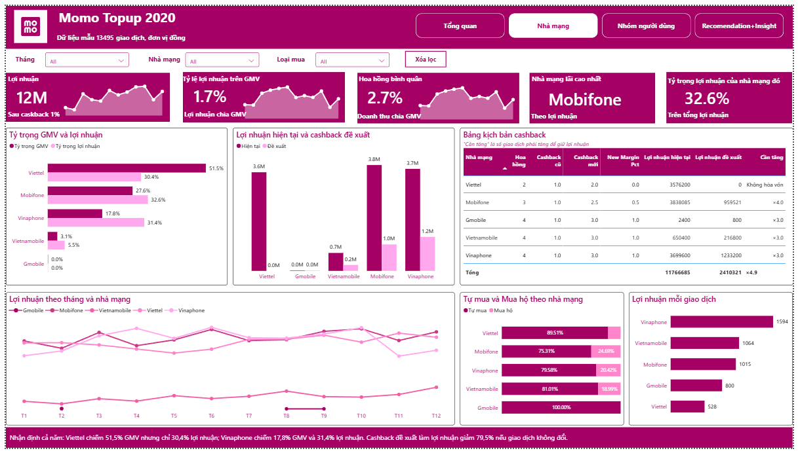
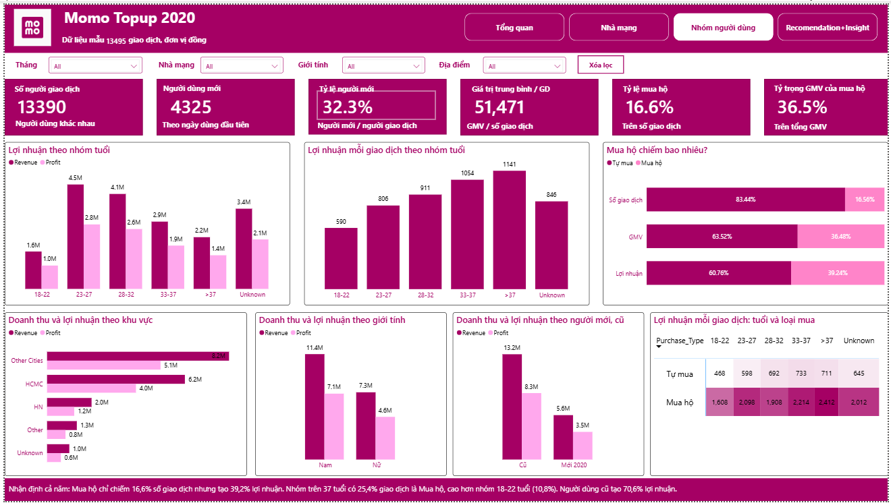
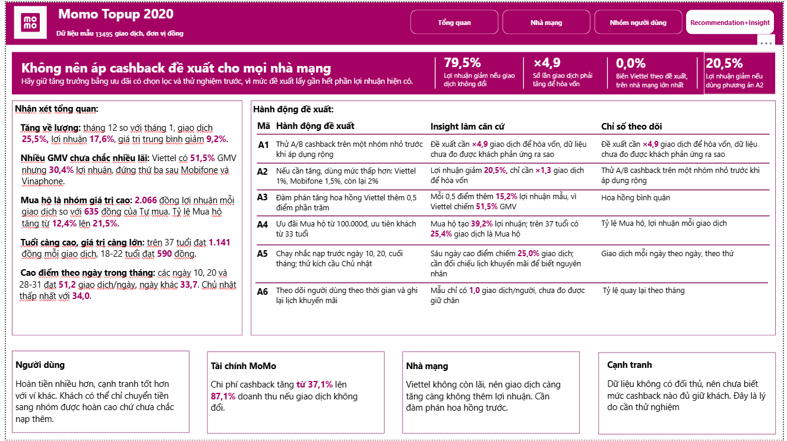

# Phân tích hiệu suất dịch vụ Topup MoMo 2020

Dự án phân tích dữ liệu giao dịch nạp tiền điện thoại (Topup) trên MoMo năm 2020 và dựng dashboard Power BI theo dõi hiệu suất, nhằm trả lời câu hỏi: **làm sao tăng trưởng Topup mà vẫn có lãi trước sức ép cashback từ đối thủ?**

> Đây là dự án cá nhân dựa trên bài take-home test, không phải sản phẩm chính thức của MoMo. Dữ liệu là mẫu nhỏ, không phản ánh quy mô thực tế của công ty.



## Mục lục

1. [Bối cảnh](#1-bối-cảnh)
2. [Dữ liệu](#2-dữ-liệu)
3. [Cấu trúc thư mục](#3-cấu-trúc-thư-mục)
4. [Quy trình thực hiện](#4-quy-trình-thực-hiện)
5. [Làm sạch dữ liệu](#5-làm-sạch-dữ-liệu)
6. [Mô hình dữ liệu và công thức](#6-mô-hình-dữ-liệu-và-công-thức)
7. [Dashboard](#7-dashboard)
8. [Cấu trúc thư mục](#8-cấu-trúc-thư-mục)
9. [Cách sử dụng](#9-cách-sử-dụng)

## 1. Bối cảnh

Khi khách nạp tiền điện thoại qua MoMo, nhà mạng trả hoa hồng cho MoMo. MoMo hoàn lại 1% cashback cho khách và giữ phần còn lại. Đối thủ đang cashback sâu, nên MoMo cân nhắc tăng cashback lên 2% đến 3% tùy nhà mạng.

| Hạng mục | Nội dung |
|---|---|
| Người dùng chính | Trưởng sản phẩm Topup |
| North Star 1 | Lợi nhuận Topup hàng tháng |
| North Star 2 | Doanh thu Topup hàng tháng |
| Góc nhìn | Tổng quan, Nhà mạng, Nhóm người dùng |

## 2. Dữ liệu

Nguồn: [`raws/3) Take-home Test_Questions.xlsx`](raws/3%29%20Take-home%20Test_Questions.xlsx)

| Bảng | Quy mô | Nội dung |
|---|---|---|
| `Transactions` | 13.495 giao dịch | Người dùng, mã đơn, ngày, số tiền, nhà mạng, trạng thái mua hộ |
| `User_Info` | 13.428 dòng, còn 13.390 người sau khi bỏ trùng | Ngày dùng đầu tiên, địa điểm, tuổi, giới tính |
| `Commission` | 5 nhà mạng | Tỷ lệ hoa hồng trả cho MoMo |

Thời gian giao dịch: 01/01/2020 đến 31/12/2020.

| Nhà mạng | Hoa hồng | Cashback hiện tại | Cashback đề xuất |
|---|---:|---:|---:|
| Viettel | 2% | 1% | 2% |
| Mobifone | 3% | 1% | 2,5% |
| Vinaphone | 4% | 1% | 3% |
| Vietnamobile | 4% | 1% | 3% |
| Gmobile | 4% | 1% | 3% |

## 3. Cấu trúc thư mục

```text
.
├── README.md
├── raws/
│   └── 3) Take-home Test_Questions.xlsx   # Dữ liệu gốc (Transactions, User_Info, Commission)
├── power_bi/
│   ├── Momo_finance_dashboard.pbix        # File Power BI (Power Query, mô hình, DAX, báo cáo)
│   └── Momo_finance_dashboard.pdf         # Bản xuất PDF của dashboard
└── images/
    ├── Modeling.png                       # Sơ đồ mô hình dữ liệu
    ├── Page_1.png                         # Trang Tổng quan
    ├── Page_2.png                         # Trang Nhà mạng
    ├── Page_3.png                         # Trang Nhóm người dùng
    └── Page_4.png                         # Trang Recommendation + Insight
```

## 4. Quy trình thực hiện

1. Thấu hiểu bên liên quan bằng 5W1H và Empathy Map
2. Xác định North Star Metric, góc nhìn và Growth Formula
3. Khám phá và làm sạch dữ liệu
4. Xây dựng mô hình dữ liệu dạng hình sao và các chỉ số
5. Thiết kế và dựng dashboard
6. Rút ra insight và đề xuất hành động

## 5. Làm sạch dữ liệu

| Vấn đề | Số dòng | Cách xử lý |
|---|---:|---|
| Ngày giao dịch dạng `27/9/2020` | 226 | Đổi về một định dạng ngày |
| `Amount` lưu dạng chữ, có dấu phẩy | Toàn bộ | Bỏ dấu phẩy, đổi sang số |
| `Purchase_status` để trống | 11.260 | Gán nhãn "Tự mua" (suy luận từ đề bài) |
| Năm sai trong ngày đầu tiên (`99xx`, `3020`) | 74 | Sửa thành `20xx` và `2020` |
| Giới tính có 8 cách ghi | Toàn bảng | Gộp về Nam và Nữ |
| "Ho Chi Minh City" và "HCMC" | 63 | Gộp làm HCMC |
| `User_id` trùng | 38 | Giữ dòng đủ thông tin nhất, nếu bằng nhau giữ dòng đầu |
| Số tiền bất thường | 9 | Giữ lại và gắn cờ (`Amount_Flag`), chiếm khoảng 1,8% GMV |

Tuổi và địa điểm `Unknown` được giữ thành nhóm riêng. "Other" và "Other Cities" được giữ riêng vì dữ liệu không giải thích khác biệt.

## 6. Mô hình dữ liệu và công thức

Mô hình hình sao gồm 1 bảng sự kiện `Transactions` và 3 bảng chiều `Users`, `Commission`, `Date`.



| Quan hệ | Khóa | Loại | Trạng thái |
|---|---|---|---|
| `Users` → `Transactions` | `User_ID` | 1:N | Kích hoạt |
| `Commission` → `Transactions` | `Merchant_ID` | 1:N | Kích hoạt |
| `Date` → `Transactions` | `Date` = `Transaction_Date` | 1:N | Kích hoạt |
| `Date` → `Users` | `Date` = `First_Tran_Date` | 1:N | Không kích hoạt (dùng cho chỉ số người dùng mới) |

| Chỉ số | Công thức |
|---|---|
| GMV | Tổng `Amount_VND` |
| Doanh thu | Tổng (`Amount_VND` × Hoa hồng %) |
| Chi phí cashback | Tổng (`Amount_VND` × `Cashback_Current_Pct`) |
| Lợi nhuận | Doanh thu − Chi phí cashback |
| Biên lợi nhuận | Lợi nhuận ÷ Doanh thu |
| Giá trị trung bình mỗi giao dịch | GMV ÷ Số giao dịch |
| Người dùng mới | Số người có `First_Tran_Date` trong kỳ |

Lợi nhuận ở đây chỉ trừ cashback, chưa gồm chi phí vận hành và marketing.

## 7. Dashboard

Khung 1920 × 1080, màu chủ đạo `#A50064`, `#FFFFFF`, `#000000`. Gồm 4 trang, chuyển trang bằng các nút ở góc trên bên phải.

- File Power BI: [`power_bi/Momo_finance_dashboard.pbix`](power_bi/Momo_finance_dashboard.pbix)
- Bản PDF xem nhanh: [`power_bi/Momo_finance_dashboard.pdf`](power_bi/Momo_finance_dashboard.pdf)

| Trang | Câu hỏi trả lời | Bộ lọc |
|---|---|---|
| 1. Tổng quan | Dịch vụ đang tốt hay xấu, thay đổi do đâu, diễn ra khi nào? | Tháng, Nhà mạng, Loại mua |
| 2. Nhà mạng | Tiền lãi đến từ đâu, cashback mới ảnh hưởng ra sao? | Tháng, Nhà mạng, Loại mua |
| 3. Nhóm người dùng | Ai mang lại giá trị cao nhất, nên nhắm vào nhóm nào? | Tháng, Nhà mạng, Giới tính, Địa điểm |
| 4. Recommendation + Insight | Kết luận và nên làm gì tiếp theo? | Không |

### Trang 1. Tổng quan

7 thẻ KPI so sánh với tháng trước (lợi nhuận, doanh thu, biên lợi nhuận, GMV, số giao dịch, giá trị trung bình, người dùng mới), xu hướng theo tháng và mức giao dịch theo ngày trong tháng, theo thứ trong tuần.


### Trang 2. Nhà mạng

So sánh tỷ trọng GMV với tỷ trọng lợi nhuận, lợi nhuận hiện tại với lợi nhuận theo cashback đề xuất, và bảng kịch bản cho biết giao dịch phải tăng bao nhiêu lần để giữ lợi nhuận.



### Trang 3. Nhóm người dùng

Lợi nhuận theo nhóm tuổi, địa điểm, giới tính, người dùng cũ/mới, và tỷ trọng Mua hộ so với Tự mua.



### Trang 4. Recommendation + Insight

Kết luận chính, nhận xét tổng quan, 6 hành động đề xuất kèm căn cứ, và tác động lên 4 bên: người dùng, tài chính MoMo, nhà mạng, cạnh tranh.



## 8. Giới hạn

- Dữ liệu là mẫu nhỏ, nên đọc theo tỷ trọng và xu hướng, không phải quy mô thật.
- Gần như mỗi người chỉ có một giao dịch, nên không đo được retention và tần suất.
- Số người dùng mới giảm từ 603 (tháng 1) xuống 76 (tháng 12) có thể do cách lấy mẫu.
- Không có dữ liệu đối thủ, mức phản ứng với khuyến mãi, lịch khuyến mãi hay mục tiêu tháng.
- Kịch bản cashback giả định số giao dịch và cơ cấu nhà mạng không đổi.


## 9. Cách sử dụng

1. Tải hoặc clone repository này.
2. Chỉ cần xem kết quả: mở [`power_bi/Momo_finance_dashboard.pdf`](power_bi/Momo_finance_dashboard.pdf).
3. Muốn tương tác: mở `power_bi/Momo_finance_dashboard.pbix` bằng Power BI Desktop.
4. Nếu Power BI báo không tìm thấy dữ liệu, vào **Transform data → Data source settings**, đổi đường dẫn tới file `raws/3) Take-home Test_Questions.xlsx` trên máy của bạn, rồi bấm **Refresh**.
5. Đối chiếu kết quả: GMV 694.604.234đ, doanh thu 18.712.727đ, lợi nhuận 11.766.685đ.
